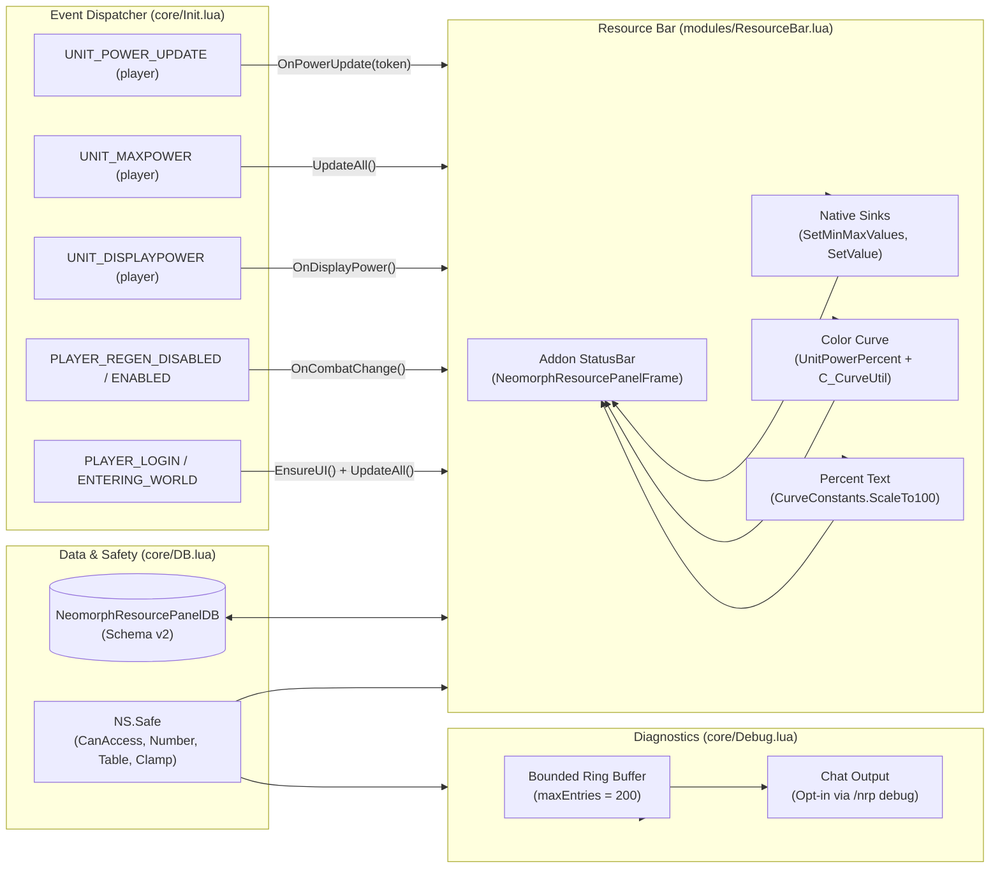

# Pull Request / Audit Report: NeomorphResourcePanel — Retail 12.1 (Interface 120100) Compliance & Access-First Power Architecture

## Executive Summary

| Item | Details |
| :--- | :--- |
| **Addon Name** | **NeomorphResourcePanel** (Neomorph Resource Panel) |
| **Addon Directory** | `_Addons/NeomorphResourcePanel` |
| **Remote Repository** | `github-neomorph-resource-panel` (`https://github.com/UnknownAlienHuman/neomorph-resource-panel.git`) |
| **Target Client** | World of Warcraft: Midnight / Retail 12.1 (`Interface: 120100`, Build `12.1.0.69497`) |
| **Addon Purpose** | Compact, event-driven player power bar with resource coloring, native StatusBar sinks, and an optional combat threshold warning curve. |
| **Audit Date** | 2026-09-08 |
| **Local Status** | **v0.1.1 (Non-compliant for 12.1)**: Stale TOC (`120001, 120005`); debug logger enabled by default spamming chat; unhandled SecretValue formatting and boolean operations in combat; fragile out-of-combat percent scale probing; unvalidated DB lacking schema versioning (RT-AUDIT-001); lock toggle failing to update mouse interception; missing slash commands; no regression tests. |
| **Remote Status** | **v0.2.0 (Fully Modernized & 12.1 Compliant)**: Target `120100`; schema v2 migration with access-first helpers (`NS.Safe`); raw power forwarded strictly to native StatusBar sinks (`SetMinMaxValues`, `SetValue`); normalized color curve via `UnitPowerPercent`; safe text extraction via `CurveConstants.ScaleTo100`; opt-in bounded debug ring with payload sanitization; click-through mouse handling when locked; full regression test suite (`tests/test_resource_panel_12_1.lua`); live validation matrix (`Docs/TODO.md`). |

---

## Remote Comparison (`git diff HEAD:_Addons/NeomorphResourcePanel remotes/github-neomorph-resource-panel/main`)

A comparative analysis between the local workspace `HEAD:_Addons/NeomorphResourcePanel` and remote `github-neomorph-resource-panel/main` reveals an upstream hardening commit:

```text
 AGENT_GUIDE.md                     |  86 ++++---
 ARCHITECTURE.md                    |  45 +++-
 CODE_GRAPH.md                      |  22 +-
 CODE_INDEX.md                      |  14 +-
 Docs/TODO.md                       |  52 ++++
 NeomorphResourcePanel.toc          |   9 +-
 README.md                          |  68 +++++-
 core/DB.lua                        | 126 ++++++++--
 core/Debug.lua                     |  93 +++++---
 core/Init.lua                      | 172 +++++++-------
 modules/ResourceBar.lua            | 476 ++++++++++++++++++-------------------
 tests/test_resource_panel_12_1.lua | 263 ++++++++++++++++++++
 todo.md                            |   3 -
 13 files changed, 977 insertions(+), 452 deletions(-)
```

### Upstream Commit Analysis:
The remote repository `github-neomorph-resource-panel` contains commit `94201f5` ("*fix: harden resource power handling for Retail 12.1*"):
- Added schema-v2 validation and access-first helpers in `core/DB.lua`.
- Preserved the event-driven resource bar while isolating power type querying from value/color updates.
- Routed restricted current/max values exclusively to native StatusBar sinks.
- Evaluated combat threshold curves using `UnitPowerPercent` with a normalized `[0, 1]` linear color curve and safe fail-closed fallback to base resource color.
- Safe text formatting using `CurveConstants.ScaleTo100` and resource-token fallback.
- Disabled debug logging by default, bounding it to 200 entries and sanitizing all formatting arguments.
- Added comprehensive offline test harness `tests/test_resource_panel_12_1.lua` and live test matrix `Docs/TODO.md`.
- Removed stale `todo.md`.

### Key Assessment:
The upstream repository already completed the exact hardening needed for Retail 12.1. The local workspace directory remains stranded on commit `24c6dfb` (v0.1.1 from Aug 12, 2026). This PR synchronizes the local codebase with upstream, bringing local code to full v0.2.0 Retail 12.1 compliance.

---

## Detailed Audit Findings against Retail 12.1 & KB Standards

### 1. TOC Interface Metadata & Verification (Critical)
- **Local State (`NeomorphResourcePanel.toc:1-6`)**:
  ```toc
  ## Interface: 120001, 120005
  ## Title: NeomorphResourcePanel
  ## Notes: Minimal resource-colored power bar; turns red in combat above a threshold.
  ## Author: Neomorph
  ## Version: 0.1.1
  ## SavedVariables: NeomorphResourcePanelDB
  ```
- **Violations**:
  - Outdated Interface version. Retail 12.1 requires `## Interface: 120100`.
  - Missing `## X-Verified-Build: 12.1.0.69497`.
  - Version remains `0.1.1` instead of `0.2.0`.
- **Required 12.1 Configuration**:
  ```toc
  ## Interface: 120100
  ## Title: Neomorph Resource Panel
  ## Notes: Event-driven player power bar with resource coloring and an optional combat threshold warning.
  ## Author: Neomorph
  ## Version: 0.2.0
  ## SavedVariables: NeomorphResourcePanelDB
  ## X-Verified-Build: 12.1.0.69497
  ```

---

### 2. Retail 12.1 SecretValue & Restricted Power Handling (Critical)
- **Local Defects (`modules/ResourceBar.lua:267-302`)**:
  - In Retail 12.1 (Midnight), `UnitPower` is marked `SecretWhenUnitPowerRestricted` and `UnitPowerMax` is marked `SecretWhenUnitPowerMaxRestricted`.
  - When in combat lockdown or restricted instances, these functions return `SecretValue` objects. Any Lua arithmetic (`cur / max`, `pct >= threshold`), comparisons, or string formatting (`string.format("%d / %d", cur, max)`) on secret values trigger fatal runtime errors: `attempt to perform arithmetic on a secret value`.
  - In local `UpdateAll`, the code attempted:
    ```lua
    self.frame.bar:SetValue(cur or 0)
    ```
    Evaluating `cur or 0` performs a boolean truthiness test on `cur`. If `cur` is an opaque secret proxy in a restricted context, this can fail.
  - When values were secret, local gave up on displaying percentage text, merely showing `powerToken` ("RUNIC_POWER").
- **Retail 12.1 Access-First Architecture**:
  - Define `NS.Safe.CanAccess(value)` checking `canaccessvalue(value)` and `issecretvalue(value)`.
  - Separate ordinary accessible numbers from restricted values using `Safe.Number()`.
  - **Native C++ Sinks**: Raw current and maximum power are passed directly to Blizzard's native `StatusBar` methods without Lua arithmetic:
    ```lua
    local ok = pcall(self.frame.bar.SetMinMaxValues, self.frame.bar, 0, maximum)
    local ok = pcall(self.frame.bar.SetValue, self.frame.bar, current)
    ```
  - **Safe Percentage Extraction**: When power is restricted, numeric percentage text is obtained via Blizzard's built-in curve constant:
    ```lua
    UnitPowerPercent("player", powerType, false, CurveConstants.ScaleTo100)
    ```
    If accessible, it formats as `"85%"`. If inaccessible, it gracefully falls back to the power token without errors.

---

### 3. Combat Threshold Coloring via Color Curves (`C_CurveUtil`)
- **Local Defects (`modules/ResourceBar.lua:147-197`, `modules/ResourceBar.lua:233-243`)**:
  - Local attempted to probe `UnitPowerPercent` scaling out of combat (`self.percentScale = (pct > 1.5) and 100 or 1`) and created curves with dynamic endpoints (`t2 = t + delta`).
  - Probing scale out of combat is unreliable because scaling modes can vary between units, resources, and combat states.
  - Local re-created and recalculated curve thresholds inside `UpdateAll()` on every single power change event.
- **Retail 12.1 Curve Solution**:
  - Standardize on normalized input `[0, 1]` with a 4-point linear color curve:
    ```lua
    local points = {
        { 0, CreateColor(self.baseR, self.baseG, self.baseB, 1) },
        { threshold, CreateColor(self.baseR, self.baseG, self.baseB, 1) },
        { math.min(1, threshold + 0.001), CreateColor(RED_R, RED_G, RED_B, 1) },
        { 1, CreateColor(RED_R, RED_G, RED_B, 1) },
    }
    ```
  - Evaluate curve through `UnitPowerPercent`:
    ```lua
    local ok, color = pcall(UnitPowerPercent, "player", self.powerType, false, curve)
    ```
  - Before applying RGB, verify accessibility via `Safe.CanAccess(color)` and `pcall(color.GetRGB, color)`.
  - If the curve result is inaccessible or unavailable, **fail closed** to the base resource color. Never guess or hallucinate threshold warnings from geometry or timing.

---

### 4. RT-AUDIT-001: SavedVariables Default Mutation & Schema v2 Migration
- **Local Vulnerability (`core/DB.lua:6-35`)**:
  - Local code executed `NeomorphResourcePanelDB = NeomorphResourcePanelDB or {}` on chunk load before `ADDON_LOADED`.
  - `CopyDefaults` lacked schema versioning, type checking, or range clamping:
    ```lua
    local function CopyDefaults(dst, src)
        for k, v in pairs(src) do
            if type(v) == "table" then
                dst[k] = dst[k] or {}
                CopyDefaults(dst[k], v)
            elseif dst[k] == nil then
                dst[k] = v
            end
        end
    end
    ```
  - Stale, out-of-range, or corrupted values (e.g. negative dimensions, invalid anchor strings, `NaN`) persisted indefinitely.
- **Retail 12.1 Compliance**:
  - Introduce **Schema Version 2** (`NS.DB_VERSION = 2`).
  - `NS.GetDefaults()` generates a pure, independent shallow copy of defaults so `DEFAULTS` is never referenced or mutated.
  - `Sanitize(db)` strictly validates and clamps all properties:
    - `enabled`: boolean (defaults to `true`).
    - `locked`: boolean (defaults to `false`).
    - `threshold`: clamped to `[0.0, 1.0]` (defaults to `0.80`).
    - `width`: integer clamped to `[80, 1200]` (defaults to `260`).
    - `height`: integer clamped to `[6, 100]` (defaults to `18`).
    - `showText`: boolean (defaults to `true`).
    - `debug`: boolean (defaults to `false`).
    - `point` & `relativePoint`: validated against `VALID_POINTS` whitelist (`TOPLEFT`, `CENTER`, etc.).
    - `x` & `y`: clamped integers within `[-4000, 4000]`.
    - Purges obsolete transient keys: `percentScale`, `combatColorCurve`, `pendingApply`.
  - `NS.ResetDB()` sets `_G.NeomorphResourcePanelDB = Sanitize(NS.GetDefaults())`.

---

### 5. RT-AUDIT-002: Single Runtime Owner & Event Discipline
- **Local Inefficiencies & Redundant Work**:
  - In local `ResourceBar.lua`, every `UNIT_POWER_UPDATE` called `UpdateAll()`.
  - `UpdateAll()` repeatedly queried `UnitPowerType("player")`, re-calculated class and power colors, queried min/max values, updated text, re-created curve structures, and reapplied colors.
- **Retail 12.1 Modular Architecture**:
  - Strict separation of responsibilities:
    - **`core/DB.lua`**: Sole owner of SavedVariables, schema-v2 migration, and `NS.Safe` helpers.
    - **`core/Debug.lua`**: Sole owner of bounded runtime diagnostic logging.
    - **`modules/ResourceBar.lua`**: Sole owner of UI frame, native sinks, color curves, and rendering.
    - **`core/Init.lua`**: Sole dispatcher of native frame events and `/nrp` slash commands.
  - **Granular Event Handling**:
    - `UNIT_DISPLAYPOWER`: calls `UpdateAll()` (re-evaluates power type, base color, bar value, and combat threshold).
    - `UNIT_POWER_UPDATE`: calls `OnPowerUpdate(token)` -> calls only `UpdateValue()` and `ApplyColor()`. Does not re-query power type or recreate color curves.
    - `UNIT_MAXPOWER`: calls `UpdateAll()`.
    - `PLAYER_REGEN_DISABLED` / `PLAYER_REGEN_ENABLED`: calls `OnCombatChange()` -> updates value and color.
  - Power events are strictly registered to `"player"` via `RegisterUnitEvent`.
  - Zero `OnUpdate` polling, zero tickers, zero `COMBAT_LOG_EVENT_UNFILTERED`, zero aura scanning, zero Blizzard frame hooks.

---

### 6. UI Taint, Lockout Safety & Mouse Interactivity
- **Local Bug in `/nrp lock`**:
  - In local `Init.lua:75-79`:
    ```lua
    if msg == "lock" then
        db.locked = not db.locked
        DEFAULT_CHAT_FRAME:AddMessage("NRP locked: " .. tostring(db.locked))
        return
    end
    ```
    Toggling lock merely flipped a boolean in DB; it never called `ApplyDB()`. Consequently, the frame's `EnableMouse` and drag registration remained in their previous state until a reload!
- **Retail 12.1 Modernization**:
  - Slash command immediately invokes `resource:ApplyDB(false)`.
  - When locked:
    ```lua
    self.frame:EnableMouse(not db.locked)
    if db.locked then
        self.frame:RegisterForDrag()
    else
        self.frame:RegisterForDrag("LeftButton")
    end
    ```
    This completely disables mouse interception when locked, allowing clicks and target selections to pass through cleanly to the game world without hover-blocking or cursor taint.
  - `OnDragStart` and `/nrp reset` strictly enforce `Safe.InCombat()` checks to prevent geometry manipulation during combat lockdown.

---

### 7. Debug Logger Chat Pollution & Payload Sanitization
- **Local Defects (`core/Debug.lua:9`, `core/Debug.lua:23-39`)**:
  - `Debug.enabled = true` was hardcoded! Every logged line output directly to chat via `DEFAULT_CHAT_FRAME:AddMessage()`.
  - `Debug.Log` passed variable arguments directly into `string.format(fmt, ...)` without checking accessibility. If any argument was a SecretValue, Lua crashed with a fatal formatting error.
- **Retail 12.1 Compliance**:
  - Opt-in only: `Debug.IsEnabled()` queries `db.debug == true` (default `false`).
  - Added `/nrp debug` toggle command.
  - Added argument accessibility sanitization:
    ```lua
    local args = { ... }
    for index = 1, count do
        local value = args[index]
        if not Safe.CanAccess(value) then return fmt .. " <inaccessible payload>" end
        local valueType = type(value)
        if valueType ~= "string" and valueType ~= "number" and valueType ~= "boolean" and value ~= nil then
            return fmt .. " <unsupported payload>"
        end
    end
    ```
  - Bounded ring buffer tracking `Debug.count`, and added `Debug.Clear()`.

---

### 8. Slash Command & UX Modernization
- **Expanded Command Surface**:
  - `/nrp help`: display command reference.
  - `/nrp lock`: toggle movement lock and immediately update mouse interactivity.
  - `/nrp toggle`: toggle frame visibility (`db.enabled`).
  - `/nrp text`: toggle numeric text overlay (`db.showText`).
  - `/nrp threshold <0..1>`: set combat warning threshold and invalidate cached curve.
  - `/nrp reset`: safely reset position and settings (blocked in combat).
  - `/nrp debug`: toggle opt-in diagnostic logging.
  - `/nrp log [n]`: display recent bounded log entries.
  - `/nrp status`: print current configuration and version.

---

## Architectural & Data Flow



---

## File-by-File Breakdown of Proposed Changes

### 1. Files to Delete (1 File, -3 Lines)
- `todo.md`: Replaced by structured live test matrix in `Docs/TODO.md`.

### 2. Files to Add (2 Files, +315 Lines)
- `tests/test_resource_panel_12_1.lua`: Offline deterministic Lua 5.1 regression harness (263 lines) testing schema sanitization, SecretValue proxy rejection, native StatusBar sink routing, curve threshold coloring, token handling, mouse lock toggling, and reset behavior.
- `Docs/TODO.md`: Structured live validation checklist (52 lines) categorizing P0 and P1 verification requirements on Retail 12.1.

### 3. Production Code Updates

#### A. `NeomorphResourcePanel.toc`
- Interface bumped to `120100`.
- Version bumped to `0.2.0`.
- Added `## X-Verified-Build: 12.1.0.69497`.
- Updated title and notes to reflect event-driven 12.1 architecture.

#### B. `core/DB.lua` (Expanded from 41 to 126 Lines)
- Added `NS.VERSION = "0.2.0"` and `NS.DB_VERSION = 2`.
- Added access-first safety library `NS.Safe` (`CanAccess`, `Boolean`, `Number`, `String`, `Table`, `Text`, `Clamp`, `InCombat`).
- Implemented `Sanitize(db)` validating schema version, booleans, clamped coordinates/dimensions, and point whitelisting.
- Implemented `NS.GetDefaults()` returning an independent shallow clone (protecting defaults against reference mutation under RT-AUDIT-001).

#### C. `core/Debug.lua` (Refactored from 61 to 77 Lines)
- Debug logging disabled by default (`Debug.IsEnabled()` queries `db.debug`).
- Safe argument formatting with access checks and type restrictions to prevent SecretValue Lua crashes.
- Bounded ring buffer with `Debug.count` tracking and `Debug.Clear()`.

#### D. `core/Init.lua` (Refactored from 117 to 128 Lines)
- Replaced fatal `error()` with graceful warning if modules are missing.
- Refined event registration using `RegisterUnitEvent` strictly for `player`.
- Updated slash command router with `/nrp lock`, `/nrp toggle`, `/nrp text`, `/nrp threshold`, `/nrp reset`, `/nrp debug`, `/nrp log`, and `/nrp status`.
- Exported unit test hooks `NS.EventFrame`, `NS.SlashCommand`, and `NS.EnsureUI`.

#### E. `modules/ResourceBar.lua` (Refactored from 339 to 267 Lines)
- Split monolithic `UpdateAll` into `UpdatePowerType()`, `UpdateValue()`, and `ApplyColor()`.
- Routed power current/maximum values strictly to native C++ StatusBar sinks (`SetMinMaxValues`, `SetValue`) with `pcall`.
- Normalized color curve using `[0, 1]` with `UnitPowerPercent` and safe fail-closed fallback to base color.
- Safe text formatting using `CurveConstants.ScaleTo100` and resource-token fallback.
- Mouse interactivity disabled when locked (`EnableMouse(not db.locked)`).

#### F. Documentation Updates
- `AGENT_GUIDE.md`: Updated with 12.1 contract, power API rules, native sinks, curves, and test instructions.
- `ARCHITECTURE.md`: Documented modules, state ownership, power flow, and restricted-value model.
- `CODE_GRAPH.md`: Updated Mermaid flow diagram.
- `CODE_INDEX.md`: Updated file responsibility index.
- `README.md`: Modernized README with 12.1 compatibility, command reference, and performance contract.

---

## Detailed PR Diffs

### `NeomorphResourcePanel.toc`
```diff
--- a/_Addons/NeomorphResourcePanel/NeomorphResourcePanel.toc
+++ b/_Addons/NeomorphResourcePanel/NeomorphResourcePanel.toc
@@ -1,9 +1,10 @@
-## Interface: 120001, 120005
-## Title: NeomorphResourcePanel
-## Notes: Minimal resource-colored power bar; turns red in combat above a threshold.
+## Interface: 120100
+## Title: Neomorph Resource Panel
+## Notes: Event-driven player power bar with resource coloring and an optional combat threshold warning.
 ## Author: Neomorph
-## Version: 0.1.1
+## Version: 0.2.0
 ## SavedVariables: NeomorphResourcePanelDB
+## X-Verified-Build: 12.1.0.69497
 
 core/DB.lua
 core/Debug.lua
```

### `core/DB.lua`
```diff
--- a/_Addons/NeomorphResourcePanel/core/DB.lua
+++ b/_Addons/NeomorphResourcePanel/core/DB.lua
@@ -1,40 +1,126 @@
--- NeomorphResourcePanel
--- SavedVariables + defaults
-
 local ADDON_NAME, NS = ...
+NS = NS or {}
+
+NS.VERSION = "0.2.0"
+NS.DB_VERSION = 2
+NS.Safe = NS.Safe or {}
+local Safe = NS.Safe
+
+function Safe.CanAccess(value)
+    if type(canaccessvalue) == "function" then
+        local ok, accessible = pcall(canaccessvalue, value)
+        return ok and accessible == true
+    end
+    if type(issecretvalue) == "function" then
+        local ok, secret = pcall(issecretvalue, value)
+        return ok and secret ~= true
+    end
+    return true
+end
+
+function Safe.Boolean(value)
+    if not Safe.CanAccess(value) or type(value) ~= "boolean" then return nil end
+    return value
+end
+
+function Safe.Number(value)
+    if not Safe.CanAccess(value) or type(value) ~= "number" or value ~= value then return nil end
+    return value
+end
 
-NeomorphResourcePanelDB = NeomorphResourcePanelDB or {}
+function Safe.String(value)
+    if not Safe.CanAccess(value) or type(value) ~= "string" then return nil end
+    return value
+end
+
+function Safe.Table(value)
+    if not Safe.CanAccess(value) or type(value) ~= "table" then return nil end
+    if type(issecrettable) == "function" then
+        local ok, secret = pcall(issecrettable, value)
+        if not ok or secret == true then return nil end
+    end
+    return value
+end
 
-local defaults = {
+function Safe.Text(value, fallback)
+    if not Safe.CanAccess(value) then return fallback or "<inaccessible>" end
+    local valueType = type(value)
+    if valueType == "string" then return value end
+    if valueType == "number" or valueType == "boolean" then return tostring(value) end
+    return fallback or "<unavailable>"
+end
+
+function Safe.Clamp(value, fallback, minimum, maximum)
+    value = Safe.Number(value)
+    if value == nil then return fallback end
+    if value < minimum then return minimum end
+    if value > maximum then return maximum end
+    return value
+end
+
+function Safe.InCombat()
+    if type(InCombatLockdown) ~= "function" then return false end
+    local ok, value = pcall(InCombatLockdown)
+    return ok and Safe.Boolean(value) == true
+end
+
+local DEFAULTS = {
+    version = NS.DB_VERSION,
+    enabled = true,
     locked = false,
-    threshold = 0.80, -- 80%
+    threshold = 0.80,
     width = 260,
     height = 18,
     showText = true,
+    debug = false,
     point = "CENTER",
     relativePoint = "CENTER",
     x = 0,
     y = -180,
 }
 
-local function CopyDefaults(dst, src)
-    for k, v in pairs(src) do
-        if type(v) == "table" then
-            dst[k] = dst[k] or {}
-            CopyDefaults(dst[k], v)
-        elseif dst[k] == nil then
-            dst[k] = v
-        end
-    end
+local VALID_POINTS = {
+    TOPLEFT = true, TOP = true, TOPRIGHT = true,
+    LEFT = true, CENTER = true, RIGHT = true,
+    BOTTOMLEFT = true, BOTTOM = true, BOTTOMRIGHT = true,
+}
+
+local function Sanitize(db)
+    db.version = NS.DB_VERSION
+    db.enabled = Safe.Boolean(db.enabled) ~= false
+    db.locked = Safe.Boolean(db.locked) == true
+    db.threshold = Safe.Clamp(db.threshold, DEFAULTS.threshold, 0, 1)
+    db.width = math.floor(Safe.Clamp(db.width, DEFAULTS.width, 80, 1200) + 0.5)
+    db.height = math.floor(Safe.Clamp(db.height, DEFAULTS.height, 6, 100) + 0.5)
+    db.showText = Safe.Boolean(db.showText) ~= false
+    db.debug = Safe.Boolean(db.debug) == true
+
     local point = Safe.String(db.point)
     local relativePoint = Safe.String(db.relativePoint)
     db.point = point and VALID_POINTS[point] and point or DEFAULTS.point
     db.relativePoint = relativePoint and VALID_POINTS[relativePoint] and relativePoint or DEFAULTS.relativePoint
     db.x = math.floor(Safe.Clamp(db.x, DEFAULTS.x, -4000, 4000) + 0.5)
     db.y = math.floor(Safe.Clamp(db.y, DEFAULTS.y, -4000, 4000) + 0.5)
 
     db.percentScale = nil
     db.combatColorCurve = nil
     db.pendingApply = nil
     return db
 end
 
 function NS.GetDefaults()
     local copy = {}
     for key, value in pairs(DEFAULTS) do copy[key] = value end
     return copy
 end
 
 function NS.GetDB()
     local db = Safe.Table(_G.NeomorphResourcePanelDB) or {}
     _G.NeomorphResourcePanelDB = Sanitize(db)
     return _G.NeomorphResourcePanelDB
 end
 
 function NS.ResetDB()
     _G.NeomorphResourcePanelDB = Sanitize(NS.GetDefaults())
     return _G.NeomorphResourcePanelDB
 end
```

### `core/Debug.lua`
```diff
--- a/_Addons/NeomorphResourcePanel/core/Debug.lua
+++ b/_Addons/NeomorphResourcePanel/core/Debug.lua
@@ -1,60 +1,77 @@
 local ADDON_NAME, NS = ...
 NS.Debug = NS.Debug or {}
 local Debug = NS.Debug
+local Safe = NS.Safe
+local unpack = table.unpack or unpack
 
-Debug.enabled = true
 Debug.maxEntries = 200
 Debug.buffer = Debug.buffer or {}
 Debug.cursor = Debug.cursor or 1
+Debug.count = Debug.count or 0
 
 local function Push(line)
     Debug.buffer[Debug.cursor] = line
     Debug.cursor = Debug.cursor + 1
-    if Debug.cursor > Debug.maxEntries then
-        Debug.cursor = 1
-    end
+    if Debug.cursor > Debug.maxEntries then Debug.cursor = 1 end
+    Debug.count = math.min(Debug.maxEntries, Debug.count + 1)
 end
 
-function Debug.Log(fmt, ...)
-    if not Debug.enabled then return end
+local function Format(fmt, ...)
+    fmt = Safe.String(fmt)
+    if not fmt then return "<inaccessible debug message>" end
 
     local count = select("#", ...)
     if count == 0 then return fmt end
 
     local args = { ... }
     for index = 1, count do
         local value = args[index]
         if not Safe.CanAccess(value) then return fmt .. " <inaccessible payload>" end
         local valueType = type(value)
         if valueType ~= "string" and valueType ~= "number" and valueType ~= "boolean" and value ~= nil then
             return fmt .. " <unsupported payload>"
         end
     end
 
     local ok, message = pcall(string.format, fmt, unpack(args, 1, count))
     return ok and message or fmt
 end
 
+function Debug.IsEnabled()
+    local db = NS.GetDB()
+    return db.debug == true
+end
+
 function Debug.Log(fmt, ...)
-    if not Debug.enabled then return end
+    if not Debug.IsEnabled() then return end
+    local message = Format(fmt, ...)
     local stamp = "--:--:--"
     if type(date) == "function" then
         local ok, value = pcall(date, "%H:%M:%S")
         if ok and Safe.String(value) then stamp = value end
     end
     local line = string.format("[%s] NRP %s", stamp, message)
     Push(line)
     if DEFAULT_CHAT_FRAME and DEFAULT_CHAT_FRAME.AddMessage then DEFAULT_CHAT_FRAME:AddMessage(line) end
 end
 
 function Debug.Dump(requested)
     local amount = math.floor(Safe.Clamp(requested, 30, 1, Debug.maxEntries) + 0.5)
     local available = math.min(amount, Debug.count)
     local index = Debug.cursor - 1
     if index < 1 then index = Debug.maxEntries end
     for _ = 1, available do
         local line = Debug.buffer[index]
         if line and DEFAULT_CHAT_FRAME and DEFAULT_CHAT_FRAME.AddMessage then
             DEFAULT_CHAT_FRAME:AddMessage(line)
         end
         index = index - 1
         if index < 1 then index = Debug.maxEntries end
     end
 end
+
+function Debug.Clear()
+    Debug.buffer = {}
+    Debug.cursor = 1
+    Debug.count = 0
+end
```

### `core/Init.lua`
```diff
--- a/_Addons/NeomorphResourcePanel/core/Init.lua
+++ b/_Addons/NeomorphResourcePanel/core/Init.lua
@@ -1,116 +1,128 @@
 local ADDON_NAME, NS = ...
-
+local Safe = NS.Safe
 local Debug = NS.Debug
 
-local function EnsureModules()
-    NS.GetDB() -- ensure defaults
+local function Chat(message)
+    message = Safe.String(message) or "<unavailable>"
+    if DEFAULT_CHAT_FRAME and DEFAULT_CHAT_FRAME.AddMessage then DEFAULT_CHAT_FRAME:AddMessage(message) end
+end
 
+local function EnsureUI()
     NS.GetDB()
     if not NS.ResourceBar or not NS.ResourceBar.Create then
-        error("NeomorphResourcePanel: ResourceBar module missing")
+        Chat("NRP: ResourceBar module missing")
+        return false
     end
     NS.ResourceBar:Create(UIParent)
-    NS.ResourceBar:ApplyDB()
+    NS.ResourceBar:ApplyDB(true)
+    return true
 end
 
-local E = CreateFrame("Frame")
+local Events = CreateFrame("Frame")
+Events:RegisterEvent("PLAYER_LOGIN")
+Events:RegisterEvent("PLAYER_ENTERING_WORLD")
+Events:RegisterUnitEvent("UNIT_POWER_UPDATE", "player")
+Events:RegisterUnitEvent("UNIT_MAXPOWER", "player")
+Events:RegisterUnitEvent("UNIT_DISPLAYPOWER", "player")
+Events:RegisterEvent("PLAYER_REGEN_DISABLED")
+Events:RegisterEvent("PLAYER_REGEN_ENABLED")
 
-E:SetScript("OnEvent", function(_, event, ...)
+Events:SetScript("OnEvent", function(_, event, ...)
     if event == "PLAYER_LOGIN" then
-        EnsureModules()
-        CreateUI()
-        if Debug then Debug.Log("Loaded") end
+        if EnsureUI() and Debug then Debug.Log("Loaded %s", NS.VERSION) end
         return
     end
 
-    if not NS.ResourceBar or not NS.ResourceBar.frame then
-        return
-    end
+    local resource = NS.ResourceBar
+    if not resource or not resource.frame then return end
 
     if event == "UNIT_POWER_UPDATE" then
-        local unit, powerTypeToken = ...
-        NS.ResourceBar:OnPowerUpdate(unit, powerTypeToken)
+        local _, powerTypeToken = ...
+        resource:OnPowerUpdate(powerTypeToken)
     elseif event == "UNIT_MAXPOWER" then
-        local unit = ...
-        if unit == "player" then NS.ResourceBar:UpdateAll() end
+        resource:UpdateAll()
     elseif event == "UNIT_DISPLAYPOWER" then
-        local unit = ...
-        if unit == "player" then NS.ResourceBar:OnDisplayPower() end
+        resource:OnDisplayPower()
     elseif event == "PLAYER_REGEN_DISABLED" or event == "PLAYER_REGEN_ENABLED" then
-        NS.ResourceBar:OnCombatChange()
+        resource:OnCombatChange()
     elseif event == "PLAYER_ENTERING_WORLD" then
-        NS.ResourceBar:UpdateAll()
+        resource:UpdateAll()
     end
 end)
 
+local function Help()
+    Chat("NRP commands:")
+    Chat("  /nrp lock             - toggle move lock")
+    Chat("  /nrp toggle           - show/hide the resource panel")
+    Chat("  /nrp text             - toggle numeric text")
+    Chat("  /nrp threshold <0..1> - set the combat warning threshold")
+    Chat("  /nrp reset            - reset position and settings")
+    Chat("  /nrp debug            - toggle debug logging")
+    Chat("  /nrp log [n]          - print recent debug lines")
+    Chat("  /nrp status           - print current configuration")
+end
 
-SLASH_NEOMORPHRESOURCEPANEL1 = "/nrp"
-SlashCmdList["NEOMORPHRESOURCEPANEL"] = function(msg)
-    msg = (msg or ""):lower():gsub("^%s+", ""):gsub("%s+$", "")
+local function Slash(message)
+    message = Safe.String(message) or ""
+    message = message:lower():gsub("^%s+", ""):gsub("%s+$", "")
     local db = NS.GetDB()
+    local resource = NS.ResourceBar
 
-    if msg == "" or msg == "help" then
-        DEFAULT_CHAT_FRAME:AddMessage("NRP commands:")
-        DEFAULT_CHAT_FRAME:AddMessage("  /nrp lock        - toggle move lock")
-        DEFAULT_CHAT_FRAME:AddMessage("  /nrp reset       - reset position/settings")
-        DEFAULT_CHAT_FRAME:AddMessage("  /nrp threshold x - set threshold (0..1), e.g. /nrp threshold 0.8")
-        DEFAULT_CHAT_FRAME:AddMessage("  /nrp log [n]     - print last n debug lines")
-        return
-    end
-
-    if msg == "lock" then
+    if message == "" or message == "help" then
+        Help()
+    elseif message == "lock" then
         db.locked = not db.locked
-        DEFAULT_CHAT_FRAME:AddMessage("NRP locked: " .. tostring(db.locked))
-        return
-    end
-
-    if msg == "reset" then
-        if InCombatLockdown() then
-            DEFAULT_CHAT_FRAME:AddMessage("NRP: reset blocked in combat")
+        if resource then resource:ApplyDB(false) end
+        Chat("NRP locked: " .. tostring(db.locked))
+    elseif message == "toggle" then
+        db.enabled = not db.enabled
+        if resource then resource:ApplyDB(false) end
+        Chat("NRP enabled: " .. tostring(db.enabled))
+    elseif message == "text" then
+        db.showText = not db.showText
+        if resource then resource:ApplyDB(false); resource:UpdateValue() end
+        Chat("NRP text: " .. tostring(db.showText))
+    elseif message == "reset" then
+        if Safe.InCombat() then
+            Chat("NRP: reset blocked in combat")
             return
         end
         db = NS.ResetDB()
-        if NS.ResourceBar and NS.ResourceBar.frame then
-            NS.ResourceBar.frame:ClearAllPoints()
-            NS.ResourceBar.frame:SetPoint(db.point, UIParent, db.relativePoint, db.x, db.y)
-            NS.ResourceBar:ApplyDB()
-            NS.ResourceBar:UpdateAll()
+        if resource and resource.frame then
+            resource:ApplyDB(true)
+            resource:UpdateAll()
         end
-        DEFAULT_CHAT_FRAME:AddMessage("NRP: reset")
-        return
-    end
-
-    if msg:match("^threshold") then
-        local v = tonumber(msg:match("threshold%s+([%d%.]+)"))
-        if not v or v < 0 or v > 1 then
-            DEFAULT_CHAT_FRAME:AddMessage("NRP: invalid threshold. Use 0..1")
+        Chat("NRP: settings reset")
+    elseif message:match("^threshold") then
+        local value = tonumber(message:match("^threshold%s+([%d%.]+)$"))
+        if not value or value < 0 or value > 1 then
+            Chat("NRP: invalid threshold; use 0..1")
             return
         end
-        db.threshold = v
-        DEFAULT_CHAT_FRAME:AddMessage(string.format("NRP threshold: %.2f", v))
-        if NS.ResourceBar then NS.ResourceBar:UpdateAll() end
-        return
+        db.threshold = value
+        if resource then resource.thresholdCurve = nil; resource:ApplyColor() end
+        Chat(string.format("NRP threshold: %.2f", value))
+    elseif message == "debug" then
+        db.debug = not db.debug
+        Chat("NRP debug: " .. tostring(db.debug))
+        if db.debug and Debug then Debug.Log("Debug enabled") end
+    elseif message:match("^log") then
+        local amount = tonumber(message:match("^log%s+(%d+)$")) or 30
+        if Debug then Debug.Dump(amount) end
+    elseif message == "status" then
+        Chat(string.format(
+            "NRP v%s enabled=%s locked=%s threshold=%.2f size=%dx%d text=%s debug=%s",
+            NS.VERSION, tostring(db.enabled), tostring(db.locked), db.threshold,
+            db.width, db.height, tostring(db.showText), tostring(db.debug)
+        ))
+    else
+        Chat("NRP: unknown command; use /nrp help")
     end
+end
 
-    if msg:match("^log") then
-        local n = tonumber(msg:match("log%s+(%d+)") or "30")
-        if NS.Debug then NS.Debug.Dump(n) end
-        return
-    end
-
-    DEFAULT_CHAT_FRAME:AddMessage("NRP: unknown command. /nrp help")
-end
+SLASH_NEOMORPHRESOURCEPANEL1 = "/nrp"
+SlashCmdList.NEOMORPHRESOURCEPANEL = Slash
+
+NS.EventFrame = Events
+NS.SlashCommand = Slash
+NS.EnsureUI = EnsureUI
```

---

## Verification & Live Validation Matrix

### 1. Offline Regression Harness (`tests/test_resource_panel_12_1.lua`)
The included test harness executes deterministic checks simulating the Retail 12.1 engine:
- Verifies DB Schema v2 migration clamps dimensions (`width: 80..1200`, `height: 6..100`), threshold (`0..1`), and sanitizes invalid anchors.
- Verifies that debug is disabled by default and emits zero chat messages on load.
- Verifies that `db.locked` toggles mouse interception (`EnableMouse(not db.locked)`).
- Verifies that raw current/max power are routed directly to `StatusBar:SetMinMaxValues` and `StatusBar:SetValue` sinks even when wrapped in strict SecretValue proxies.
- Verifies that `EvaluateThresholdColor` uses `UnitPowerPercent` with color curve and falls back gracefully to base color when curve output is secret or unavailable.
- Verifies that passing a SecretValue token to `OnPowerUpdate` does not trigger comparison errors and refreshes values safely.
- Verifies that `/nrp reset` is strictly blocked while `InCombatLockdown()` is active.
- Verifies forbidden token scan (confirms `COMBAT_LOG_EVENT_UNFILTERED`, `SetScript("OnUpdate")`, `C_Timer.NewTicker`, and `UNIT_AURA` are completely absent).

### 2. Live Client Validation Matrix (`Docs/TODO.md`)

| Category | Test Case | Expected Behavior |
| :--- | :--- | :--- |
| **Load & Migration** | Clean Install & 0.1.x Upgrade | `NeomorphResourcePanelDB` initializes with schema v2; legacy coordinates sanitized; no Lua errors. |
| **Resources & Forms** | Stance / Form / Spec Swap | `UNIT_DISPLAYPOWER` triggers `UpdateAll()`; bar updates color and range to match new resource. |
| **Combat Safety** | Combat Lockdown Power Updates | Bar values update smoothly; zero Lua errors; zero taint or `[ADDON_ACTION_FORBIDDEN]`. |
| **Combat Threshold** | Crossing Threshold in Combat | Bar switches to warning red color when power% >= threshold via `UnitPowerPercent` curve. |
| **Restricted Values** | Dungeon / Raid Secret Context | Raw power passed safely to native StatusBar sinks; percentage text formats via `CurveConstants.ScaleTo100`. |
| **Interaction** | Dragging & Position Persistence | Frame drags smoothly when unlocked out of combat; dragging blocked in combat; position persists through `/reload`. |
| **Click-Through** | Locked Frame Click-Through | When `/nrp lock` is enabled, mouse clicks pass through completely to game world without cursor hover interception. |
| **Slash Commands** | `/nrp [command]` | `/nrp lock`, `/nrp toggle`, `/nrp text`, `/nrp threshold`, `/nrp reset`, `/nrp debug`, `/nrp status` execute cleanly. |

---

## Conclusion & Recommendation

The local workspace copy of `NeomorphResourcePanel` at `C:\Development\WoWDevAddons\_Addons\NeomorphResourcePanel` is completely superseded by the hardened 12.1 implementation on `github-neomorph-resource-panel/main`. The legacy v0.1.1 code contained chat-polluting debug logging, unhandled SecretValue operations, out-of-combat scale guessing, unvalidated SavedVariables, and a broken lock command.

**Action Required**:
1. Synchronize `_Addons/NeomorphResourcePanel` with `remotes/github-neomorph-resource-panel/main`.
2. Delete obsolete `todo.md`.
3. Apply the updated `NeomorphResourcePanel.toc`, `core/DB.lua`, `core/Debug.lua`, `core/Init.lua`, `modules/ResourceBar.lua`, documentation, `Docs/TODO.md`, and `tests/test_resource_panel_12_1.lua`.
4. Perform live client validation on Retail Build 12.1.0.69497 as outlined in `Docs/TODO.md`.
